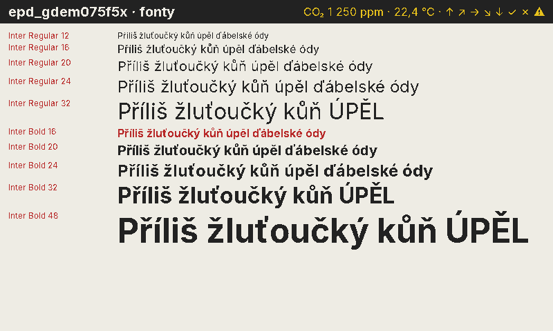
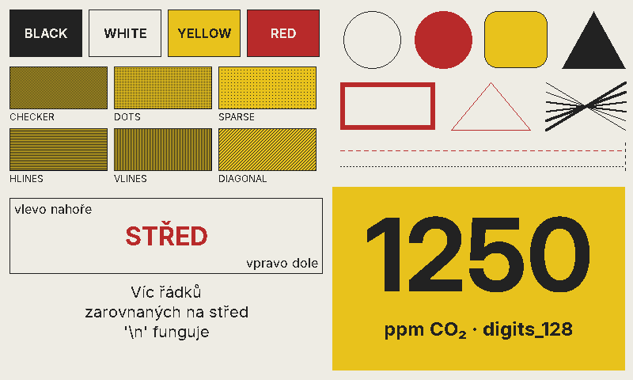

# epd_gdem075f5x

ESP-IDF komponenta pro 7,5″ čtyřbarevný e-paper **Good Display GDEM075F52 / GDEM075F53**
(800 × 480 px, černá / bílá / žlutá / červená, řadič JD79665) na desce **LaskaKit ESPink v3.x**
(ESP32-S3).

Obsahuje:

- **driver** panelu (SPI přes DMA, timeout na BUSY, chybové kódy, měření doby překreslení,
  vypínání napájení displeje před deep sleepem),
- **grafiku** nezávislou na hardwaru: rotace, ořez, čáry (i tlusté a čárkované), obdélníky,
  zaoblené obdélníky, kružnice, trojúhelníky, vzory pro „odstíny“, 1bitové a 2bitové obrázky,
- **text v UTF-8** s češtinou a slovenštinou, zarovnání, víc řádků, text v boxu, `printf`,
- **14 fontů** (Inter) včetně velkých číslic čitelných na několik metrů,
- **nástroje**: převod vlastních fontů a obrázků, **náhled na PC** (vykreslí obrazovku do BMP),
- **příklady**: `hello` a `showcase`.

Odzkoušeno na ESPink v3.6 s GDEM075F53. Příklady jsou přeložené v ESP-IDF 5.3 pro ESP32-S3.



---

## Obsah

1. [Instalace](#instalace)
2. [Rychlý start](#rychlý-start)
3. [Zapojení](#zapojení)
4. [Jak funguje překreslení](#jak-funguje-překreslení)
5. [API: driver](#api-driver)
6. [API: kreslení](#api-kreslení)
7. [Text a fonty](#text-a-fonty)
8. [Obrázky](#obrázky)
9. [Náhled na PC](#náhled-na-pc)
10. [Příklady](#příklady)
11. [Řešení problémů](#řešení-problémů)
12. [Licence](#licence)

---

## Instalace

Složku `epd_gdem075f5x` zkopírujte do složky `components/` vašeho projektu:

```
muj_projekt/
├── CMakeLists.txt
├── components/
│   └── epd_gdem075f5x/      ← sem
└── main/  (nebo src/ u PlatformIO)
```

**ESP-IDF (`idf.py`):** komponenta se najde sama. V `main/CMakeLists.txt` ji uveďte v `REQUIRES`:

```cmake
idf_component_register(SRCS "main.c" REQUIRES epd_gdem075f5x)
```

**PlatformIO (`framework = espidf`):** stejná složka `components/` v kořeni projektu.
PlatformIO u ESP-IDF používá jeho CMake, takže by se komponenta měla přeložit automaticky
(odzkoušené je sestavení přes `idf.py`).
Pokud váš `src/CMakeLists.txt` používá `REQUIRES`, přidejte do něj `epd_gdem075f5x`.

**Bez kopírování:** v kořenovém `CMakeLists.txt` projektu před `include(... project.cmake)`:

```cmake
set(EXTRA_COMPONENT_DIRS "cesta/k/epd_gdem075f5x")
```

Požadavky: ESP-IDF 5.0 nebo novější. Komponenta potřebuje 96 kB RAM na framebuffer
a 4 kB na DMA buffer.

---

## Rychlý start

```c
#include "epd_gdem075f5x.h"
#include "epd_gfx.h"
#include "epd_fonts.h"

void app_main(void)
{
    epd_config_t cfg = EPD_CONFIG_ESPINK_V3();
    ESP_ERROR_CHECK(epd_init(&cfg));

    epd_canvas_t *c = epd_canvas_create(EPD_ROT_0);      // bílé plátno 800x480

    epd_gfx_text(c, 20, 20, "Učebna SE3.143", &epd_font_inter_bold_32, EPD_BLACK);
    epd_gfx_fill_rect(c, 20, 80, 300, 160, EPD_YELLOW);
    epd_gfx_text_box(c, 20, 80, 300, 160, "1245", &epd_font_digits_96, EPD_BLACK,
                     EPD_ALIGN_CENTER, EPD_ALIGN_MIDDLE);

    ESP_ERROR_CHECK(epd_show(c->fb));     // inicializace, zápis, překreslení (~15 s), uspání panelu

    epd_canvas_free(c);
    epd_prepare_deep_sleep();             // vypne napájení displeje a podrží ho vypnuté
    esp_deep_sleep(10ULL * 60 * 1000000); // za 10 minut znovu
}
```

---

## Zapojení

Piny ESPink v3.x (převzaté z LaskaKit dema, ověřené na v3.6) obsahuje makro `EPD_CONFIG_ESPINK_V3()`:

| Signál | GPIO | Poznámka |
|---|---|---|
| MOSI (SDA) | 11 | |
| SCK | 12 | |
| CS | 10 | |
| DC | 48 | 0 = příkaz, 1 = data |
| RST | 45 | aktivní v nule |
| BUSY | 38 | 0 = pracuje, 1 = volno |
| POWER | 47 | tranzistor napájení displeje, HIGH = zapnuto |

SPI: mód 0, 10 MHz, MISO se nepoužívá. Pro jinou desku si vyplňte vlastní `epd_config_t`.
Pokud deska nemá spínač napájení, dejte `.power = GPIO_NUM_NC`.

Pokud na stejné SPI sběrnici visí jiné zařízení, inicializujte sběrnici jako první.
`epd_init()` ji pak jen převezme a `epd_deinit()` ji neuvolní.

---

## Jak funguje překreslení

Driver umí jen celé překreslení (demo výrobce pro tento panel jiné nemá). Každá změna obrazu
proto znamená:

1. `epd_panel_init()`: reset, inicializační sekvence, zapnutí zdrojů panelu,
2. `epd_write_frame()`: příkaz `0x10` a 96 000 B obrazu,
3. `epd_refresh()`: příkaz `0x12` a čekání na BUSY. Trvá zhruba 12–20 s (podle teploty).
   Displej během toho bliká, to je normální,
4. `epd_panel_sleep()`: vypnutí zdrojů a hluboký spánek panelu.

`epd_show()` udělá všechny čtyři kroky a panel uspí vždy, i po chybě.
`epd_show_color()` vyplní celý displej jednou barvou bez framebufferu
(hodí se na občasné „vyčištění“ proti duchům).

**Pravidla od výrobce**, která driver dodržuje nebo je musíte dodržet vy:

- po každém překreslení panel uspat (jinak se zkracuje životnost),
- před každým překreslením znovu inicializovat,
- nepřipojovat ani neodpojovat FPC kabel displeje pod napětím.

**Měření pro energetickou bilanci:** `epd_last_refresh_ms()` vrací, jak dlouho trvalo
poslední překreslení (doba, kdy byl BUSY v nule). Spotřebu během ní si změřte ampérmetrem.

**Deep sleep:** `epd_prepare_deep_sleep()` stáhne POWER do nuly a zapne držení pinu
(`gpio_hold_en`), aby displej zůstal bez napájení i během spánku. Po probuzení `epd_init()`
držení zase uvolní.

---

## API: driver

Hlavička `epd_gdem075f5x.h`. Všechny funkce vrací `esp_err_t`, pokud není uvedeno jinak.

| Funkce | Popis |
|---|---|
| `epd_init(&cfg)` | GPIO, SPI, zapnutí napájení displeje. Druhé volání nic nedělá. |
| `epd_deinit()` | Vypne napájení, uvolní SPI. |
| `epd_show(fb)` | Celé překreslení z framebufferu (blokuje ~15 s). |
| `epd_show_color(barva)` | Celý displej jednou barvou. |
| `epd_last_refresh_ms()` | Doba posledního překreslení v ms (`uint32_t`). |
| `epd_power(bool)` | Ruční zapnutí / vypnutí napájení displeje. |
| `epd_prepare_deep_sleep()` | Napájení vypnout a podržet před `esp_deep_sleep()`. |
| `epd_panel_init()`, `epd_write_frame(fb)`, `epd_refresh()`, `epd_panel_sleep()` | Jednotlivé kroky překreslení. |
| `epd_send(cmd, data, len)` | Surový příkaz pro experimenty. |

Chyby: `ESP_ERR_TIMEOUT` (BUSY se neuvolnil do `busy_timeout_ms`, výchozí 60 s),
`ESP_ERR_INVALID_STATE` (chybí `epd_init`), chyby SPI.

Driver není thread-safe. Volejte ho z jednoho tasku.

---

## API: kreslení

Hlavička `epd_gfx.h`. Je to čisté C bez závislostí na ESP-IDF.

### Plátno

```c
epd_canvas_t *c = epd_canvas_create(EPD_ROT_0);   // malloc 96 kB, vyplněno bílou
epd_canvas_free(c);

static uint8_t fb[EPD_FB_SIZE];                   // nebo vlastní buffer (statický, PSRAM...)
epd_canvas_t canvas;
epd_canvas_init(&canvas, fb, EPD_ROT_90);         // obsah bufferu se nemění
```

- Souřadnice jsou logické, tedy po rotaci: (0, 0) je vlevo nahoře.
  `c->width` a `c->height` jsou 800 × 480 (`EPD_ROT_0/180`) nebo 480 × 800 (`EPD_ROT_90/270`).
- Kreslit mimo plátno je bezpečné, vše se ořízne.
- `epd_canvas_set_clip(c, x, y, w, h)` omezí kreslení na obdélník, `epd_canvas_reset_clip(c)` ho zruší.

### Barvy

`EPD_BLACK`, `EPD_WHITE`, `EPD_YELLOW`, `EPD_RED`. `EPD_TRANSPARENT` jde použít jen jako pozadí
(u 1bitových obrázků) nebo jako „nekreslit“.

### Primitiva

| Funkce | |
|---|---|
| `epd_gfx_clear(c, barva)` | vyplnit celé plátno |
| `epd_gfx_pixel(c, x, y, barva)`, `epd_gfx_get_pixel(c, x, y)` | |
| `epd_gfx_hline(c, x, y, w, barva)`, `epd_gfx_vline(c, x, y, h, barva)` | |
| `epd_gfx_hline_dashed(c, x, y, w, dash, gap, barva)`, `epd_gfx_vline_dashed(...)` | čárkovaná (hranice v grafu) |
| `epd_gfx_line(c, x0, y0, x1, y1, barva)` | Bresenham |
| `epd_gfx_line_thick(c, x0, y0, x1, y1, tloušťka, barva)` | křivky grafů |
| `epd_gfx_rect`, `epd_gfx_fill_rect`, `epd_gfx_rect_thick(..., tloušťka, barva)` | rámeček dovnitř |
| `epd_gfx_round_rect`, `epd_gfx_fill_round_rect(..., r, barva)` | |
| `epd_gfx_circle`, `epd_gfx_fill_circle(c, cx, cy, r, barva)` | |
| `epd_gfx_triangle`, `epd_gfx_fill_triangle(c, x0, y0, x1, y1, x2, y2, barva)` | šipky trendu |
| `epd_gfx_fill_rect_pattern(c, x, y, w, h, fg, bg, vzor)` | „odstíny“, `bg` může být průhledné |

Vzory: `EPD_PATTERN_CHECKER` (50 %), `DOTS` (25 %), `SPARSE` (~6 %), `HLINES`, `VLINES`, `DIAGONAL`.
Hodí se třeba na podbarvení pásem v grafu.



---

## Text a fonty

```c
epd_gfx_text(c, x, y, "Text", &font, barva);                 // (x, y) = levý horní roh řádku
epd_gfx_textf(c, x, y, &font, barva, "%d ppm", co2);         // printf, max 255 znaků
epd_gfx_text_aligned(c, x, y, "A\nBB", &font, barva, EPD_ALIGN_CENTER);  // vůči x
epd_gfx_text_box(c, x, y, w, h, "1245", &font, barva, EPD_ALIGN_CENTER, EPD_ALIGN_MIDDLE);
int w = epd_text_width(&font, "Text");
int h = epd_text_height(&font, "Řádek 1\nŘádek 2");
```

- Řetězce jsou v **UTF-8**, takže diakritiku pište normálně. Soubory ukládejte v UTF-8.
- `\n` zalomí řádek. Automatické zalamování slov komponenta nedělá.
- Znak, který ve fontu není, se vykreslí jako `?`.
- `EPD_ALIGN_MIDDLE` v `epd_gfx_text_box` centruje výšku velkých písmen a číslic,
  takže čísla v dlaždicích sedí opticky uprostřed. Text se ořízne na box.
- Baseline řádku je na `y + font->ascent`, další řádek o `font->line_height` níž.

### Dodávané fonty

Deklarované jsou v `epd_fonts.h`. Fonty, které nepoužijete, linker zahodí a nestojí žádnou flash.

| Font | Identifikátor | Výška řádku | Výška verzálek | Na displeji | Flash |
|---|---|---|---|---|---|
| Inter Regular 12 | `epd_font_inter_regular_12` | 15 px | 9 px | 1,8 mm | 9,9 kB |
| Inter Regular 16 | `epd_font_inter_regular_16` | 20 px | 12 px | 2,4 mm | 16,6 kB |
| Inter Regular 20 | `epd_font_inter_regular_20` | 25 px | 14 px | 2,9 mm | 18,3 kB |
| Inter Regular 24 | `epd_font_inter_regular_24` | 30 px | 17 px | 3,5 mm | 20,1 kB |
| Inter Regular 32 | `epd_font_inter_regular_32` | 39 px | 24 px | 4,9 mm | 24,6 kB |
| Inter Bold 16 | `epd_font_inter_bold_16` | 20 px | 12 px | 2,4 mm | 16,7 kB |
| Inter Bold 20 | `epd_font_inter_bold_20` | 25 px | 14 px | 2,9 mm | 18,6 kB |
| Inter Bold 24 | `epd_font_inter_bold_24` | 30 px | 17 px | 3,5 mm | 21,3 kB |
| Inter Bold 32 | `epd_font_inter_bold_32` | 39 px | 24 px | 4,9 mm | 27,7 kB |
| Inter Bold 48 | `epd_font_inter_bold_48` | 59 px | 36 px | 7,3 mm | 39,4 kB |
| Inter Display Bold 64 | `epd_font_digits_64` | 78 px | 47 px | 9,6 mm | 3,6 kB |
| Inter Display Bold 96 | `epd_font_digits_96` | 117 px | 71 px | 14,5 mm | 7,2 kB |
| Inter Display Bold 128 | `epd_font_digits_128` | 155 px | 95 px | 19,4 mm | 12,2 kB |
| Inter Display Bold 160 | `epd_font_digits_160` | 194 px | 118 px | 24,1 mm | 18,7 kB |

Rozměr na displeji je přepočtený roztečí pixelu 0,204 mm. Flash zahrnuje i tabulku kerningu.

**Textové fonty** obsahují ASCII, českou a slovenskou abecedu,
`° ± × · – — − … € µ ² ³ ‰ ₀–₉` a symboly `← ↑ → ↓ ↗ ↘ ▲ ▼ ● ○ ✓ ✗ ⚠`.
CO₂ se tedy píše přímo jako `"CO₂"`.

**Fonty `digits_*`** obsahují jen `0123456789 .,:-+%°/` a mezeru, aby byly malé.
Čtyřmístné číslo je široké asi 142–156 px v `digits_64`, 213–236 px v `digits_96`,
285–316 px v `digits_128` a 355–392 px v `digits_160` (podle číslic, `1` je nejužší). Při třech sloupcích vedle sebe (266 px na učebnu) se tedy vejde
nejvýš `digits_96`.

**Čitelnost ze 3 m:** výška číslic v `digits_96` je 14,5 mm, v `digits_128` 19,4 mm.
Jestli to stačí, ověřte na místě. Podle zadání čitelnost stejně posuzují lidé.


### Vlastní font

Generátor potřebuje Python a FreeType (`pip install freetype-py`). S `uharfbuzz`
(`pip install uharfbuzz`) navíc převezme z fontu kerning (dvojice jako AV, Te, °C);
bez něj se font vygeneruje bez kerningu:

```sh
python3 tools/fontconvert.py MujFont.ttf 40 muj_font_40 --chars cz,arrows -o muj_font_40.c
```

Vygenerovaný `.c` soubor přidejte do projektu (nebo do `fonts/` komponenty)
a deklarujte ho: `extern const epd_font_t muj_font_40;`

- `--chars`: kombinace `ascii`, `cz`, `arrows`, `digits` nebo přímo výčet znaků, např.
  `--chars "0123456789ppm "`.
- Velikost je em v pixelech (jako ve Wordu při 72 dpi).
- Pod 60 px se glyfy srovnají auto-hinterem FreeType v režimu „light“ (jen svisle), takže
  všechna písmena sedí na stejné účaří a mají stejnou výšku malých i velkých písmen; pak se
  vykreslí s vyhlazením a prahují na 1 bit. Od 60 px se kreslí bez hintingu (obrys už je
  přesný). Režim lze vynutit přes `--hinting light|none`.
- `--threshold` (výchozí 128) určuje, od jakého pokrytí je pixel černý; nižší hodnota,
  např. 100, dá o něco tučnější tahy.

Celou sadu dodávaných fontů znovu vygeneruje `tools/gen_bundled_fonts.py`
(potřebuje Inter, na Ubuntu balík `fonts-inter`).

---

## Obrázky

```sh
python3 tools/img2epd.py logo.png logo -W 200 -o logo.c        # vytvoří logo.c, logo.h a náhled
```

```c
#include "logo.h"
epd_gfx_bitmap2(c, 10, 10, LOGO_WIDTH, LOGO_HEIGHT, logo, EPD_TRANSPARENT);
```

Obrázek se převede na čtyři barvy panelu s ditheringem (Floyd–Steinberg).
Pro loga a ikony použijte `--no-dither`. Vedle `.c` se uloží `*.preview.png`, abyste
výsledek viděli dřív, než ho nahrajete.

1bitové bitmapy (např. ikony z jiných knihoven) kreslí
`epd_gfx_bitmap1(c, x, y, w, h, data, fg, bg)`. Řádky jsou zarovnané na celé bajty, MSB první.

---

## Náhled na PC

Grafika i fonty jdou přeložit obyčejným překladačem, takže rozložení obrazovky jde ladit
bez čekání 20 s na každé překreslení:

```sh
cd host
make run          # vytvoří preview_*.bmp (fonty, tvary)
./preview 2       # dvojnásobné zvětšení
```

Funguje na Linuxu, macOS a ve Windows přes WSL nebo MSYS2. Pro vlastní obrazovku přidejte svůj
kreslicí `.c` soubor do `SRC` v `host/Makefile` a zavolejte ho z `preview_main.c`. Kreslicí kód
držte odděleně od ESP-IDF kódu (data → struktura → `draw(canvas, &data)`).

Barvy v náhledu jsou jen přibližné.

---

## Příklady

Každý příklad je samostatný ESP-IDF projekt, který používá komponentu ze složky o dvě úrovně výš:

```sh
cd examples/hello
idf.py set-target esp32s3
idf.py build flash monitor
```

| Příklad | Co ukazuje |
|---|---|
| `hello` | minimum: init, pár tvarů a textů, jedno překreslení |
| `showcase` | všechny fonty, barvy, vzory, tvary, zarovnání; nakonec displej vybílí |

---

## Řešení problémů

| Příznak | Co zkontrolovat |
|---|---|
| `BUSY timeout` hned při init | napájení displeje (`.power`), pin BUSY, FPC kabel, verze desky |
| displej se nepřekreslí, BUSY nikdy nespadne | CS, DC, SPI piny |
| barvy jsou prohozené | framebuffer z jiného zdroje než `epd_gfx` (Good Display demo používá u obrázků jiné kódy barev) |
| místo písmen `?` | znak není ve fontu, nebo zdroják není uložený v UTF-8 |
| zůstávají duchové předchozího obrazu | občas (např. jednou denně) `epd_show_color(EPD_WHITE)` a pak obraz |
| `out of memory` | `epd_canvas_create` chce 96 kB souvislé paměti, použijte statický buffer nebo PSRAM s `epd_canvas_init` |
| displej nebo baterie se ve spánku vybíjí | před `esp_deep_sleep()` zavolejte `epd_prepare_deep_sleep()` |

---

## Struktura

```
epd_gdem075f5x/
├── include/
│   ├── epd_gdem075f5x.h    driver (ESP-IDF)
│   ├── epd_gfx.h           kreslení a text (čisté C)
│   ├── epd_font.h          formát fontu
│   ├── epd_fonts.h         dodávané fonty
│   └── epd_types.h         rozměry, barvy
├── src/                    implementace
├── fonts/                  vygenerované fonty + licence Inter
├── tools/                  fontconvert.py, gen_bundled_fonts.py, img2epd.py
├── host/                   náhled na PC
├── examples/               hello, showcase
└── docs/                   obrázky do README
```

---

## Licence

Kód je pod licencí MIT (soubor `LICENSE`). Inicializační sekvence panelu pochází z dema
Good Display, které distribuuje LaskaKit. Fonty jsou vygenerované z Inter
(SIL Open Font License 1.1, `fonts/LICENSE-Inter.txt`).
